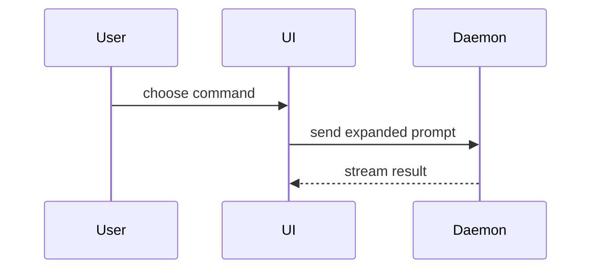

- Показывай логику и алгоритмы используя псевдокод:

```text
on(save)
  if content is unchanged
    return cached result
  write new content
  return fresh result
```

- Показывай runtime control flow как дерево вызовов:

```text
submitForm
  createSession
    persistPrompt
    launchAgent
  navigateToSession
```

- Показывай UI структуру как дерево компонентов, включая текущее состояние и границы модулей, которые имеют значение:

```tsx
<SessionPage> (apps/example/src/routes/session.tsx)
  useSessionEvents()
  <SessionToolbar>
    <RunSkillButton> (packages/ui)
```

- Показывай взаимодействие компонетнтов, цепочку вызовов или передачу данных как Mermaid диаграмму:



- Используй `diff` чтобы подсветить что изменилось:
```diff
 <SessionPage>
   useSessionEvents()
   <SessionToolbar>
+    <RunSkillButton />
   <SessionTimeline>
+    <SkillResultCard />
```

Для изменения или отображения структуры файлов:

```diff
 src/
 ├── commands/
+│   └── show-me.ts       # expands the slash command
 ├── sessions/
-└── transport.ts
+└── transport/
+    ├── client.ts
+    └── stream.ts
```

Для отображения состояния или измененения структуры вызовов:

```diff
 submitForm
   createSession
     persistPrompt
+    expandSkillMention
     launchAgent
-  navigateToSession
+  navigateToSession
+    subscribeToEvents
```

Для отображения состояния или изменения control-flow:

```diff
 on(save)
-  write content
+  if content is unchanged
+    return cached result
+  write new content
+  invalidate cache
```
